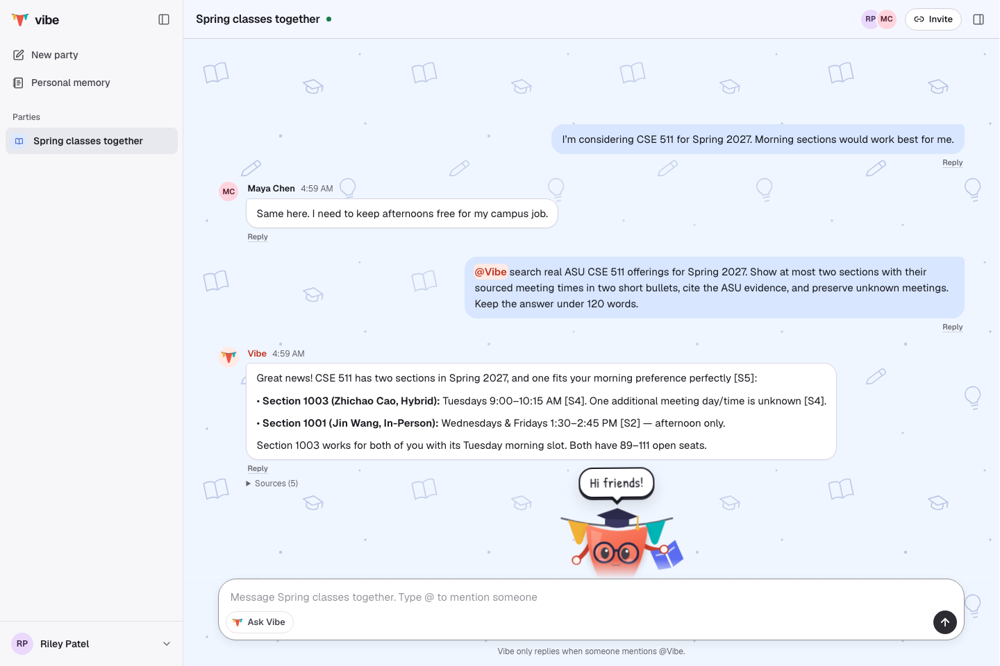
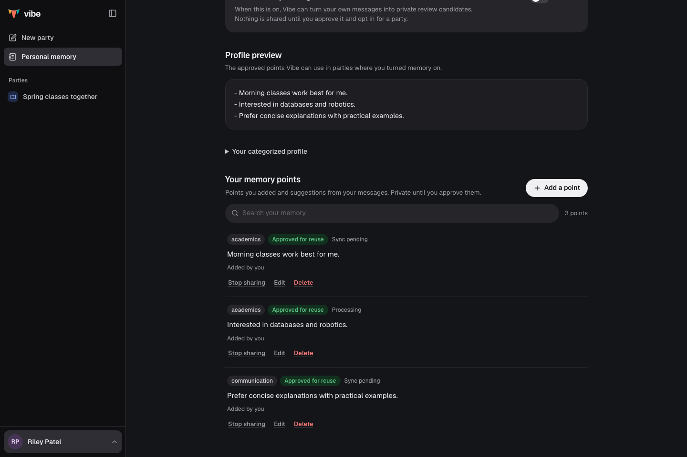
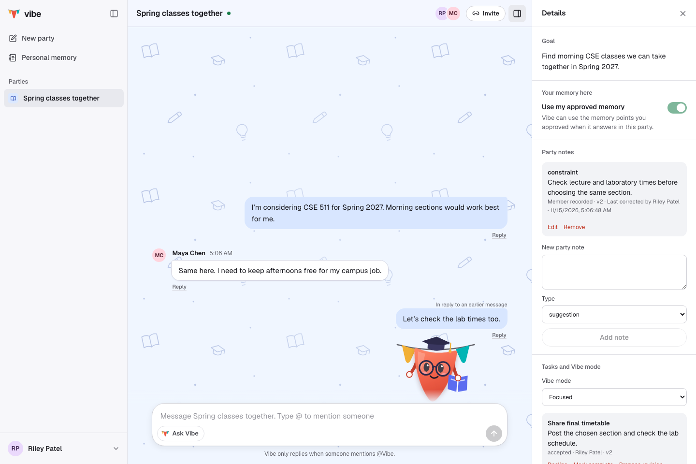
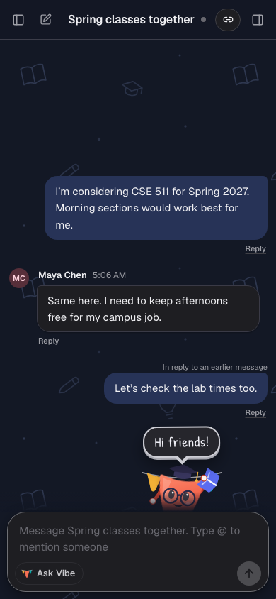
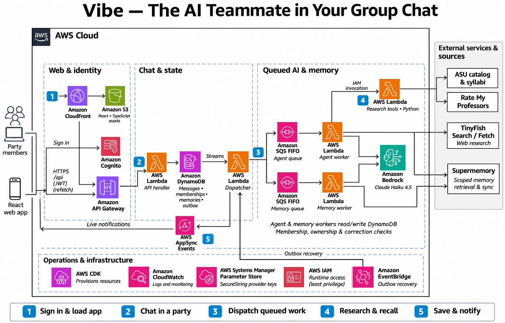

# Vibe

An AI teammate in your group chat. Bring classmates, friends or teammates into a **party**, discuss a shared goal, and mention **@Vibe** for research, suggestions and practical next steps.

Vibe combines persistent group conversations, permission-aware personal memory and sourced research. It helps a group take classes together, brainstorm a hackathon, plan a trip or organize a shared project.

[Open Vibe](https://d1ia555vbcj8k2.cloudfront.net) · [Setup](#local-development) · [Architecture](#architecture) · [Deployment and handoff](STATUS.md)



## Features

| Capability | How it works |
| --- | --- |
| Group collaboration | Create parties around a goal, invite people by link or QR code, exchange live messages and reply to earlier proposals. |
| An agent in the conversation | Mention @Vibe for help. Choose Focused, Friendly or Banter for the party's conversational tone. |
| Personal memory with consent | Add points manually or enable learning. Review private candidates, approve reusable points and choose which parties may use them. |
| Contextual group memory | Retain attributed decisions, constraints and open questions. Short agreements become sourced participation records, with uncertainty and withdrawal represented explicitly. |
| Class and professor research | Search real ASU offerings, inspect syllabus evidence, resolve professors, read bounded Rate My Professors samples and compare supplied meeting intervals. |
| General web research | TinyFish Search and Fetch supply public evidence with source links and retrieval timestamps. |
| Shared tasks | Propose assignments, claim or accept your own work, decline and complete tasks. Revisions require renewed acceptance. The agent can propose tasks through typed tools. |
| A contextual interface | Party names and goals select a matching chat background and Pip's accessories. Light/dark/system themes, highlighted mentions and mascot controls follow the same visual language. |

### Memory you can inspect

Personal points have owners, source references, versions, approval and provider-sync states. Canonical corrections govern subsequent use while provider indexing catches up. Editing and deletion protect against stale extraction jobs restoring older facts.

Learning and sharing have separate controls. Enabling learning creates private review candidates. Cross-party reuse additionally requires approval and the party's sharing opt-in. A one-time agreement to join camping stays scoped to that party's plan.



### Plans that require real acceptance

The party details panel brings together its goal, sharing controls, editable notes, participation, tasks, people and background selection. Task proposals persist across reloads. People accept their own assignments, and material changes create a new proposal version.



<details>
<summary>Mobile layout</summary>



</details>

Screenshots use temporary demonstration accounts in the deployed application. Their data is removed after capture.

## Architecture



The diagram shows the core chat, memory and research topology. EventBridge also discovers eligible idle-learning work, and SES sends application invitations through a verified sender.

| Layer | Services and responsibilities |
| --- | --- |
| Web and identity | React 19, TypeScript and Vite; private S3 hosting through CloudFront; Cognito accounts and JWT authentication. |
| API and live updates | API Gateway HTTP API and a TypeScript Lambda; AppSync Events publishes membership-scoped refresh notifications. |
| Canonical state | DynamoDB stores parties, memberships, messages, memory versions, participation, tasks and durable outbox records. |
| Background work | DynamoDB Streams dispatches outbox work to SQS FIFO queues. Lambda workers process agent and memory jobs. EventBridge recovers pending effects and discovers idle work. |
| Models and tools | Amazon Bedrock Converse uses Claude Haiku 4.5. A bounded native tool loop validates arguments and persists requests/results. |
| Memory | Supermemory v5 indexes party history and personal facts in separate namespaces. DynamoDB remains authoritative for ownership, approval, expiry, corrections and deletion. |
| Research | An IAM-invoked Python Lambda wraps the reused ASU/RMP retrieval modules. TinyFish provides general public web search and fetch. |
| Operations | AWS CDK provisions infrastructure; CloudWatch records operational/model metadata; IAM scopes runtime permissions; SSM stores provider keys and the invitation sender. |

### Request lifecycle

1. A signed-in member sends a message with an idempotency ID. The API checks membership and transactionally writes the message and its outbox work.
2. AppSync signals party members to refresh canonical state. An @Vibe mention also creates a queued agent run.
3. The agent loads bounded history, current party facts and approved memory from opted-in members. Typed research/task tools execute within the run budget.
4. The completed answer, citations and action results are persisted before notification. Queue retries reuse recorded results.
5. Memory extraction runs separately. Quiet-user discovery starts after two minutes of party inactivity and uses the five-minute recovery schedule. Private candidates and shared contextual notes follow their own ownership rules.

The selected model is `us.anthropic.claude-haiku-4-5-20251001-v1:0`. The shared deployment runs in AWS `us-east-2`.

## Local development

### Prerequisites

- Node.js **24+** and npm.
- Public configuration for the deployed Cognito/API/AppSync services.
- Python with pip for building research deployment assets. The packaged runtime targets Linux x86_64 Python 3.12.
- Authorized AWS credentials for infrastructure work, plus account access to the selected Bedrock inference profile.

### Run the web app

```sh
git clone --branch anish/implementation https://github.com/aniiishhh/vibe.git
cd vibe
npm ci
cp web/.env.example web/.env.local
```

Fill `web/.env.local` with the deployment's public identifiers. The current shared values are recorded in [STATUS.md](STATUS.md).

| Variable | Value to supply |
| --- | --- |
| `VITE_REGION` | AWS region, currently `us-east-2` |
| `VITE_USER_POOL_ID` | Cognito user pool ID |
| `VITE_USER_POOL_CLIENT_ID` | Cognito public app client ID |
| `VITE_API_URL` | Absolute API Gateway URL ending in `/api` for local development |
| `VITE_EVENTS_HTTP_ENDPOINT` | AppSync Events HTTP endpoint |
| `VITE_EVENTS_REALTIME_ENDPOINT` | Corresponding AppSync realtime endpoint |

```sh
npm run dev
```

Open the Vite URL, then sign in or create an account. Local frontend development connects to the configured real backend. The production build loads `/config.json` and uses the same-origin `/api` path through CloudFront. Provider API keys belong on the server.

### Checks and builds

```sh
npm run typecheck
npm test
npm run build
```

The research asset is needed before infrastructure synthesis. Its builder downloads pinned Linux Python 3.12 wheels into ignored `research/dist/`.

```sh
npm run build:research
```

For focused Python adapter checks, prepare a local environment once.

```sh
python3 -m venv .venv
.venv/bin/python -m pip install -r research/requirements.txt pytest
npm run test:research
```

## AWS deployment

Select your authorized AWS profile and verify its identity before deploying. The CDK application defaults to the project's shared account; set the target account explicitly when reproducing the stack.

```sh
export AWS_PROFILE=your-authorized-profile
export AWS_REGION=us-east-2
export VIBE_AWS_ACCOUNT=your-account-id
export VIBE_AWS_REGION=us-east-2
export VIBE_LOW_QUOTA=false
```

Prepare these parameters in the target account and region before deployment.

| SSM parameter | Type | Purpose |
| --- | --- | --- |
| `/vibe/dev/supermemory-api-key` | `SecureString` | Supermemory v5 server credential |
| `/vibe/dev/tinyfish-api-key` | `SecureString` | TinyFish server credential |
| `/vibe/dev/invite-sender` | `String` | SES-verified sender email address used by the invitation API |

Verify the SES sender in Ohio and enable account access to the selected Bedrock model/profile. In a fresh account, bootstrap CDK once with an authorized deployment role.

```sh
npm exec -w infra -- cdk bootstrap "aws://$VIBE_AWS_ACCOUNT/$VIBE_AWS_REGION"
```

Build, inspect and deploy the stack.

```sh
npm run build:research
npm run build
npm run synth
npm run diff -w infra
npm run deploy -w infra
```

The stack outputs the website URL and public service identifiers. Production configuration is deployed with the frontend. Persistent resources have retention policies. The latest stack state, deployment replication details and verification evidence are maintained in [STATUS.md](STATUS.md).

## Current service boundaries

- **Email invitations** use SES. The shared account is sandboxed, so delivery is available to verified addresses, the mailbox simulator and addresses at verified domains. Arbitrary-recipient delivery requires AWS production access.
- **Research evidence** has explicit time, result and context budgets. ASU/RMP interfaces are unofficial, professor reviews are samples, and syllabi or meeting details can be missing. Answers retain source/coverage uncertainty.
- **Memory processing** is asynchronous. Idle discovery normally occurs roughly two to seven minutes after the final message, followed by queue/provider processing. Approval, membership and canonical versions govern reuse.

## Repository structure

```text
web/          React interface, themes, backdrops, Pip and client API
backend/      Authenticated API, agent, memory, tasks and event workers
research/     Python ASU/RMP adapter and pinned retrieval modules
shared/       Client/server TypeScript contracts
infra/        AWS CDK stack and deployment entry point
docs/         Product, architecture, implementation plan and evidence
  assets/     Website screenshots and the supplied architecture diagram
scripts/      Asset builders and bounded verification utilities
```

## Project documentation

- [Product idea](docs/product-idea.md)
- [Architecture and trust boundaries](docs/architecture.md)
- [Technical research](docs/technical-research.md)
- [Implementation plan](docs/implementation-plan.md)
- [Current deployment and handoff](STATUS.md)
- [Research setup and source provenance](research/README.md)

## Attribution and AI assistance

Vibe was built for Sunhacks 2026. The UI integrates the team's `anish/ui` theme, backgrounds, mentions and Pip mascot with the current application features. The architecture diagram was supplied by the project team.

ASU class-search and Rate My Professors retrieval reuse the team's earlier SameClass/Ray modules at revision `3292dea39915a9c8f611d638847af0414ecfce27`, under project-specific authorization. Upstream attribution and reuse details are recorded in the research documentation. [Source provenance](research/README.md)

Codex and coding agents assisted with planning, implementation, research and focused verification. The team reviewed the product direction and deployment choices. Verification scope and remaining limitations are recorded in the status and result reports. [Verification history](STATUS.md)
