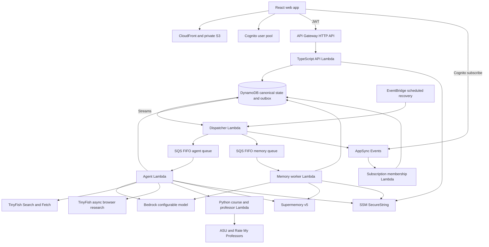

# Vibe architecture

Prepared November 14, 2026, America/Phoenix. Readiness review confirmed AWS identity, the existing budget, provider key presence, Supermemory authenticated reads, and TinyFish Search/Fetch. The model audit covered all 84 text entries returned in Ohio and tested eight model IDs. DeepSeek V3.2 is the selected operational model, with MiniMax M2.5 as fallback. Product requirements are in `product-idea.md`.

## 1. Selected stack

| Concern | Selection | Reason |
| --- | --- | --- |
| Web application | React 19, TypeScript, Vite | Responsive client with a simple static deployment |
| UI | Tailwind CSS 4, Radix primitives, Lucide icons | Accessible controls and custom visual identity |
| Navigation and server state | React Router 7, TanStack Query 5 | Party URLs, paginated history, cache invalidation and reconnection |
| Markdown and QR | react-markdown with remark-gfm, qrcode | Cited answers and locally generated invite QR codes |
| Identity | Amazon Cognito user pool, public app client, email/password with email verification | Persistent user `sub` across parties |
| Browser AWS client | aws-amplify 6 auth and Events modules | Cognito session handling and AppSync subscriptions |
| HTTP API | API Gateway HTTP API with JWT authorizer, TypeScript Lambda on Node.js 24 | Party, chat, memory and task endpoints |
| Application database | One DynamoDB table, on-demand, PITR, Streams | Canonical state and atomic conditional writes |
| Live delivery | AWS AppSync Events | Managed WebSocket notifications |
| Agent execution | TypeScript Lambda, bounded application-owned tool loop | Explicit permissions, budgets and persisted actions |
| Model | Bedrock Converse, `deepseek.v3.2`; fallback `minimax.minimax-m2.5` | Both passed live tool round trips; DeepSeek followed the class-planning task instruction most closely in a synthetic check |
| Automatic extraction | Selected operational model with a separate short extraction prompt | One model integration with independently bounded background work |
| Long-term memory | Hosted Supermemory API v5, official `supermemory` 5.x SDK | Namespaced ingestion, graph memory, profiles and search |
| General research | TinyFish Search and Fetch, official `@tiny-fish/sdk` | Current sources and rendered page content using the user's credits |
| Interactive research | TinyFish TinyAgent asynchronous runs | Read-only browser research when a source requires interaction |
| Course and professor tools | Existing SameClass Python retrieval modules, Python 3.12 Lambda with a typed invocation adapter | Reuses the authorized ASU/RMP evidence capabilities |
| Async work | SQS FIFO agent queue and FIFO memory queue, each with a DLQ | Serial execution within a party or namespace and recoverable work |
| Reliable dispatch | DynamoDB outbox, Streams dispatcher Lambda, scheduled recovery | Preserves work across database/queue/publish failures |
| Secrets | SSM Parameter Store SecureString, runtime IAM roles | Server-only Supermemory and TinyFish keys |
| Hosting | Private S3 bucket and CloudFront with Origin Access Control | Static frontend and same-origin `/api/*` proxy |
| Infrastructure | AWS CDK v2 in TypeScript | Reproducible resources named `Vibe-<stage>` and tagged `project=vibe` |
| Operations | CloudWatch structured logs, metrics, alarms, AWS Budgets | Error visibility, usage measurement and spend notification |
| Verification | Vitest, Playwright, existing Python pytest suite | Targeted state, permissions, browser and retrieval checks |

The user selected account `851725603471` and primary region `us-east-2`. AWS MCP currently authenticates as IAM user `anishk`. The existing account-level `Monthly Budget $50` is confirmed, with actual and forecast notifications configured. This budget also covers other account usage. Supermemory and TinyFish have separate provider billing. US-prefixed Bedrock inference can route within supported US regions.

Library compatibility was checked through Context7 for Amplify Events, TanStack Query and FastAPI/Mangum. Exact dependency versions will be locked during scaffolding. The inspected registry currently reports Supermemory 5.1.2, TinyFish SDK 0.11.0, CDK 2.277.0 and Bedrock Runtime SDK 3.1169.0.

## 2. Model decision

Use DeepSeek V3.2 for conversation, tool selection, short summaries and background extraction. The endpoint is `bedrock-runtime.us-east-2.amazonaws.com`, using `deepseek.v3.2` through AWS SDK v3 and the Lambda execution role. Its live Converse tool-result round trip succeeded. US Standard pricing is $0.62 per million input tokens and $1.85 per million output tokens. MiniMax M2.5 also passed and costs $0.30/$1.20. The model ID remains configurable. [DeepSeek model card](https://docs.aws.amazon.com/bedrock/latest/userguide/model-card-deepseek-deepseek-v3-2.html), [AWS pricing](https://aws.amazon.com/bedrock/pricing/)

The user requested a wider account-level comparison after the Haiku denial. DeepSeek, MiniMax, gpt-oss-120b and Kimi K2.5 passed tool round trips. In one synthetic class-planning case, DeepSeek proposed verifying prerequisites and lab requirements before enrollment. gpt-oss proposed enrollment while acknowledging unverified eligibility. MiniMax needed more than a 1,024-token bound in the first scenario. These observations support the initial selection but require broader regression checks during implementation. Full evidence is in `model-availability.md`.

| Option | Decision |
| --- | --- |
| DeepSeek V3.2, `deepseek.v3.2` | Selected main agent and extraction model |
| MiniMax M2.5, `minimax.minimax-m2.5` | Tested operational fallback |
| gpt-oss-120b, `openai.gpt-oss-120b-1:0` | Working alternative, with task-content issues in the small scenario |
| Kimi K2.5, `moonshotai.kimi-k2.5` | Tool test passed, at $0.60/$3.00 US Standard |
| Claude Haiku 5.5 | Invocation denied for this account |
| Claude Sonnet 4.6 and Haiku 4.5 | Invocation requires the account's Anthropic use-case form |
| Nova 2 Lite | Tool test passed; retained in the audit |
| GLM 4.7 Flash | Public card and live catalog disagree on lifecycle. Runtime remains untested |
| DeepSeek V4.1 Flash | Bedrock availability could not be established from the current official catalog |

The account-level test confirmed DeepSeek's Converse tool selection and tool-result handling on `bedrock-runtime` in Ohio. Additional checks will cover tool errors, schema validation and bounded context during implementation.

The fallback is a configuration change following a measured check. Retry transient provider errors within the run budget. A model change during a run must resume from persisted successful tool results and preserve action IDs.

The selected loop uses client-side tools executed by Vibe's backend. Each tool has a Zod schema, an authenticated context and an allowlisted implementation. Sources and messages are untrusted input. [Bedrock tool execution](https://docs.aws.amazon.com/bedrock/latest/userguide/tool-use.html)

## 3. Deployment topology

Lambda functions use the default managed network with outbound HTTPS for external APIs. Each has its own scoped role. The course function is invoked directly through the AWS Lambda API by the agent role, with no public Function URL. Deployment packages include only the approved retrieval modules and their dependencies.

CloudFront serves the SPA and forwards authenticated `/api/*` calls without caching private responses. Deep links resolve to the SPA without turning API errors into HTML. AppSync uses its own managed endpoint.

## 4. Message and agent lifecycle

1. The browser sends a message with a random `clientId`. The backend derives the author from Cognito and checks current party membership.
2. A DynamoDB transaction writes the message, author-scoped idempotency record and durable outbox work. A matched mention or authorized clarification reply also creates an AgentRun and its outbox item.
3. The dispatcher handles outbox records and sends the run ID to SQS FIFO with `MessageGroupId=partyId`. Membership is rechecked when the worker starts.
4. The worker acquires a conditional run lease, captures the trigger's message boundary, and loads current canonical facts and permitted memory. Processing uses an explicit snapshot boundary so a queued run does not unexpectedly answer a later question.
5. The model executes at most four tool rounds. Persist each model response and its tool calls before executing mutations. Each successful mutation records a stable action ID derived from run, recorded tool call and item index. Retries resume those recorded calls and return existing results. Mutation transactions validate the current permissions and memory revision used to produce the action.
6. The worker rechecks the membership and memory revisions used by the answer before committing. Changed permissions cause cancellation. A changed preference causes one bounded regeneration using current data, then a visible retry state if changes continue.
7. A transaction commits the completed reply, final run status and notification outbox. Task tool results are durable even when later answer generation fails, and the UI can show those results independently.

SQS FIFO serializes delivery within its message group. Duplicate delivery remains an expected condition, handled by run leases, deterministic action IDs and conditional writes. Canonical message IDs define chat ordering. Transport arrival order does not establish original wall-clock order. [Lambda and SQS](https://docs.aws.amazon.com/lambda/latest/dg/with-sqs.html)

Each external effect has its own outbox record. The dispatcher marks delivery only after acknowledgment. It may redeliver after a crash, and consumers deduplicate. Filter the Streams subscription to new pending outbox items so status updates do not recursively dispatch work. A five-minute scheduled pass queries pending outbox work by due time and repairs missed dispatches. Failed effects remain visible in the outbox and DLQ. [Transactional outbox](https://docs.aws.amazon.com/prescriptive-guidance/latest/cloud-design-patterns/transactional-outbox.html)

## 5. Real-time authorization and UX

Clients subscribe to `/party/<partyId>` using Cognito. A synchronous `onSubscribe` Lambda checks membership and rejects wildcards. Only IAM backend roles publish. Use the request/response integration so authorization affects the subscription result. [Event API authorization](https://docs.aws.amazon.com/appsync/latest/eventapi/configure-event-api-auth.html), [Lambda integration](https://docs.aws.amazon.com/appsync/latest/eventapi/direct-lambda-integrations.html)

For the first release, events carry opaque change IDs and refresh signals. Message text, memory text, source URLs, tasks and run details come from authenticated HTTP reads. This lets removal from a party take effect on subsequent reads even when an earlier WebSocket subscription remains open. Reconnect, tab focus and a bounded fallback refresh repair missed notifications.

The initial UI shows queued, thinking, researching, ready and failed states and displays the completed reply. Token-by-token rendering is a follow-up enhancement. This selection reduces event fan-out and keeps sensitive content behind a fresh HTTP membership check.

## 6. Memory design

### Namespaces and ownership

Use a dedicated Vibe Supermemory organization or project key. Namespace names include environment and opaque application IDs.

| Namespace | Ingested content | Allowed retrieval |
| --- | --- | --- |
| `vibe-<stage>-party-<id>` | Attributed party conversation blocks and party facts | Current members of that party |
| `vibe-<stage>-user--private` | Sanitized, self-authored personal memory candidates and manual private notes | Owner's memory view and review workflow |
| `vibe-<stage>-user--shared` | Owner-approved reusable facts only | A party agent when the owner is a member and opted in there |

The backend derives namespace IDs and gates every call. Separate private and shared namespaces keep private source discussion outside the group agent's retrieval path. Supermemory scopes each request to one namespace. [Namespace behavior](https://supermemory.ai/docs/concepts/container-tags.md)

### Exact Supermemory features

- Document ingestion with `taskType: "memory"` for approved personal facts and selected party decisions.
- SuperRAG ingestion with `taskType: "superrag"` for attributed historical conversation blocks. This retains searchable source text without generating personal facts from every line.
- Namespace-scoped `search` for relevant memories or chunks.
- `profile` and profile buckets for compact owner-facing previews and cached summaries. Buckets such as preferences, academics and travel organize content.
- Document `get` and `list` for processing status and source inspection.
- Explicit `documents.update` content replacement for revisions, document deletion and exact memory forgetting for cleanup.
- `dreaming: "instant"` for small approved facts in the live demo. Observe completion status because accepted ingestion and completed extraction are separate states.

Supermemory creates derived memories from ingested documents. Profile bucket summaries can aggregate several memories, so they cannot be mapped automatically to one approval record. Group prompts use canonically validated facts and source chunks. A compact summary can enter a group prompt only when its complete input set is known and currently permitted. [Ingestion](https://supermemory.ai/docs/ingestion/add-memories.md), [Profile buckets](https://supermemory.ai/docs/user-profiles/buckets.md)

### Automatic accumulation and manual edits

The Milestone 2 implementation enqueues bounded extraction work for each author on their @Vibe request or after ten pending messages from that author. Runs are deduplicated by source boundary. Extract each speaker's own explicit durable statements with message IDs. A third-party claim cannot write another person's profile. Vibe-created prose and web pages cannot establish a personal preference.

The owner enables automatic learning during onboarding. Learned facts begin as candidates visible in the private memory view. Approval promotes a fact to the shared namespace. A manually added point can be saved private or approved for reuse. Per-party sharing defaults off.

Every canonical fact stores `factId`, owner/speaker, text, category, source message and party IDs, timestamps, expiry, version, approval state, sharing state, correction links and sync state. Store an approval and the approved fact version together.

A correction transaction updates the canonical fact, increments the owner's `memoryRevision`, records superseded sources and enqueues synchronization. Permission revocation and deletion invalidate reuse immediately. Tombstones prevent old extraction jobs from recreating deleted facts. Jobs load the latest canonical version before syncing.

For deletion, inspect per-document provider results as well as HTTP status. Supermemory can return partial failures, including a document that is still processing. Keep deletion jobs pending and retry those IDs after processing ends. The canonical tombstone suppresses reuse throughout cleanup. Show provider cleanup as pending until confirmed and prevent late ingestion completion from restoring the fact. [Deletion response contract](https://supermemory.ai/docs/migration/api-v5-document-reads#delete-documents)

The v5 add operation with an existing ID supports append/diff behavior. A correction uses the explicit replacement operation and verifies processing. A stable ID alone does not establish replacement. [Document operations](https://supermemory.ai/docs/ingestion/document-operations.md), [Replacement semantics](https://supermemory.ai/docs/migration/api-v5-document-updates.md)

### Retrieval and bounded context

1. Read current membership, party facts, sharing settings, personal fact versions and correction records from DynamoDB.
2. Load recent attributed messages up to the trigger boundary and the context limit.
3. Search only the current party namespace for older relevant discussion.
4. Search shared namespaces for relevant, opted-in participant facts, with bounded parallel requests.
5. Validate returned document IDs, fact versions and source access against canonical records. Rehydrate approved text from DynamoDB. Discard unknown, deleted, expired or superseded results.
6. Exclude superseded source spans and earlier assistant answers whose recorded memory dependencies changed. Supply current correction records explicitly. Verify this behavior with contradictory-history scenarios.
7. Assemble a bounded context with stable user attribution and source labels.

An owner sees their complete permitted provenance. Other party members see only reusable fact text and owner attribution when the source belongs to another party. Source links require independent access checks.

Initial context budgets are design settings to tune after measurement. Recent chat is at most 40 messages and 12,000 characters. Personal memory is at most five relevant facts per person and 2,000 tokens across the group. Party facts and historical retrieval share another 2,000-token allowance. Preserve required hard constraints or ask for a narrower question when they exceed the budget. Profile previews target about 1,500 characters per person and offer a full searchable view.

The canonical representation is structured. Markdown is a rendering and export format. A cached summary carries its source IDs and revision and is invalidated by edits. A long-lived frozen snapshot cannot override a current correction.

## 7. Course and professor research

The user authorized using `sameclass-track3/class_search_api/` and `sameclass-track3/rmp_api/`. Their FastAPI apps are self-contained and their retrieval code has no database or LLM dependency. They expose typed JSON envelopes, timestamps, pagination and explicit source failures. The source files also show retry and deadline limitations that need a bounded wrapper. [Existing API guide](../sameclass-track3/docs/api-guide.md), [Source provenance](../sameclass-track3/SOURCE_NOTES.md)

Package the two retrieval modules in a Python 3.12 Lambda. A new thin dispatcher invokes allowlisted Python client operations directly. The agent calls it using IAM `InvokeFunction`. Local developers can still run the existing FastAPI servers with uvicorn. Mangum is an available adapter if an HTTP deployment becomes necessary, and remains outside the selected direct-invocation path. [Mangum adapter](https://github.com/Kludex/mangum/blob/main/docs/adapter.md)

| Runtime tool | Existing capability |
| --- | --- |
| `search_classes` | Sections by term, subject, course and bounded filters |
| `get_course_details` | Description and prerequisite text |
| `get_syllabus_evidence` | Exact offering first, then explicitly labeled fallback |
| `find_professors` | Candidate identity lookup by school, name and department |
| `get_professor_reviews` | Paginated review text, dates and coverage |
| `compare_group_schedules` | New deterministic comparison over normalized meetings and user constraints |

Each result includes source identity, term, URL, retrieval time, coverage and warnings. Keep research outputs bounded below Lambda payload limits. Use professor identity resolution before interpreting reviews. Syllabus evidence retains its actual term and instructor. Unknown meetings remain unknown, and lecture/lab bundles require explicit compatibility data.

Start with two search pages, five candidate sections, two professors and two review pages per professor. Cache public observations in DynamoDB using every query dimension, source timestamp and an explicit freshness interval. Refresh seat observations on request. Respect upstream 429/503 responses and returned Retry-After. The original timeout budgets are checked between calls, so the outer Lambda deadline and worker deadline must cap total work.

The planned integration supports course research in the first release. Live ASU/RMP health and Lambda packaging still need testing. The user authorized reuse for the build. Event eligibility for using an older service remains an organizer interpretation to record before submission.

## 8. General web tools

Use TinyFish Search for source discovery and Fetch for source text. Return citation IDs, URLs, titles, access time and excerpts to the model. Store citations on the final reply and reject fabricated citation IDs. Cache only public, nonsensitive results by query/URL and freshness. [Search reference](https://docs.tinyfish.ai/search-api/reference.md), [Fetch reference](https://docs.tinyfish.ai/fetch-api/reference.md)

TinyAgent is a separate, asynchronous research job when a public site needs navigation or form interaction for retrieval. Save its provider run ID, poll through a queued continuation, enforce `max_duration_seconds`, and support cancellation. The documented `max_steps` feature is beta, so a wall-clock bound is required independently. Use an isolated browser context for public-source retrieval and allowlisted goals. User-account actions, booking and enrollment need their own later product flow. [TinyAgent limits](https://docs.tinyfish.ai/agent/explanation/agent-modes.md)

Initial limits are two searches, three fetched pages and 12,000 extracted characters across web tools per agent run. Search has a ten-second timeout. Fetch sets a per-URL budget of 20 seconds plus a client deadline. Browser jobs have a 120-second provider bound and become visible pending jobs while they run. External pages are evidence, and instructions within them cannot grant tool permissions.

## 9. Data access and schema

Access patterns determine the table design.

| Access pattern | Key/query |
| --- | --- |
| Check membership | Strong GetItem of party member |
| List my parties | GSI1 membership entries by user, then authorized metadata reads |
| Load history | Party partition, message sort-key prefix, cursor pagination |
| Read plan and party facts | Party partition with task/fact prefixes |
| Read/edit personal memory | Owner partition with preference prefix |
| Redeem invite | Hashed token key and atomic membership creation |
| Deduplicate send | Author and client ID within party |
| Resume agent | Party run record and conditional lease |
| Recover pending effects | Sparse GSI2 by outbox state and due time |
| Cache public research | Hashed full query and source key |

| Entity | PK | SK |
| --- | --- | --- |
| User | `USER#sub` | `PROFILE` |
| Personal memory | `USER#sub` | `PREF#factId` |
| Party | `PARTY#id` | `META` |
| Membership and sharing settings | `PARTY#id` | `MEMBER#sub` |
| Message | `PARTY#id` | `MSG#ulid` |
| Send idempotency | `PARTY#id` | `CLIENT#sub#clientId` |
| Agent run | `PARTY#id` | `RUN#triggerMessageId` |
| Tool action | `PARTY#id` | `ACTION#runId#toolCallId#index` |
| Task | `PARTY#id` | `TASK#id` |
| Party fact | `PARTY#id` | `FACT#id` |
| Invite | `INVITE#tokenHash` | `META` |
| Outbox effect | `OUTBOX#id` | `META` |
| Research cache | `CACHE#queryHash` | `META` |
| Rate counter | `RATE#scope#id` | `WINDOW#start` |

GSI1 uses `USER#sub` and `PARTY#joinedAt#partyId` on membership records. GSI2 uses a small fixed set of pending-outbox shards and `dueAt#effectId`. Indexes help discover work. Authorization and correction-sensitive reads use base-table canonical records. Expiry is checked explicitly because physical TTL deletion is asynchronous.

Transactions condition-check membership while changing party state and atomically write idempotency and outbox effects. Conflict responses return the current version for a user retry. [DynamoDB transactions](https://docs.aws.amazon.com/amazondynamodb/latest/developerguide/transaction-apis.html)

## 10. Task state and invitations

Task states are `proposed`, `accepted`, `done`, `declined` and `cancelled`. Edit history is a versioned property. A proposed assignee accepts their own task. An unassigned task can be claimed atomically. Completion is performed by its accepted assignee. Material changes to assignee, scope or due time return the task to proposed. AI tools propose assignments and edits and record actual tool outcomes.

Link and QR invitations use the same high-entropy token, hashed at rest, expiring and revocable. A link grants the opportunity to join after sign-in. Email-restricted invitations additionally compare the verified account email.

For application-sent email, Amazon SES is selected subject to a verified sender and recipient-delivery access. New sandbox accounts can send only to verified recipients. Link/QR joining is the first milestone, and email delivery is a separate integration gate. A share-by-email action can use the device's email composer in the meantime. [SES access](https://docs.aws.amazon.com/ses/latest/dg/request-production-access.html)

## 11. Execution limits and operations

| Setting | Initial value |
| --- | --- |
| Model output per call | 2,048 tokens, including any billed reasoning output |
| Tool rounds per run | 4 |
| Total model calls including final answer | 5 |
| Normal agent deadline / Lambda timeout | 120 seconds / 150 seconds |
| Agent queue batch size / visibility timeout | 1 / 900 seconds |
| Python research timeout | 90 seconds, additionally bounded by caller deadline |
| Memory worker timeout / queue visibility | 90 seconds / 540 seconds |
| Agent rate per party / per person | 30 per hour / 100 per day |
| Agent reserved concurrency | 5 |
| Message size | 4,000 characters |
| Log retention | 14 days |
| Delivered outbox retention | 7 days |

These are tunable implementation settings. They are recorded so capacity and cost can be estimated. Persisted counters gate model calls, extraction and browser jobs, with a project-wide disable switch for metered features. Rate limits and budget notifications bound normal use but do not establish an exact dollar cap.

Log request, party, run and action IDs, timings, usage, source statuses and errors. Keep raw chat, review bodies, keys and signed syllabus URLs out of operational logs. Secrets are read at cold start from `/vibe/<stage>/supermemory-api-key` and `/vibe/<stage>/tinyfish-api-key` with narrow `ssm:GetParameter` and decryption permissions.

## 12. Architectural tradeoffs

| Decision | Tradeoff |
| --- | --- |
| Lambda agent hosting | Fits bounded runs and the shared serverless deployment. Long browser work uses resumable jobs |
| AgentCore Runtime | Evaluated as a future host if long-lived sessions or runtime features justify another deployment surface |
| AppSync refresh notifications | Adds HTTP reads but keeps authorization current and reconnect recovery simple |
| DynamoDB canonical state plus Supermemory | Requires synchronization, while preserving immediate corrections and explicit permissions |
| Three personal/party memory boundaries | Adds private/shared sync operations while preventing aggregate profiles from mixing private and shareable content |
| Direct Python Lambda tools | Preserves existing retrieval code and adds a second language package |
| Custom bounded tool loop | Keeps state transitions explicit and avoids another orchestration dependency for the first release |

The selected services cover identity, collaboration, agent execution, memory, research, hosting and operations. The requirements assign long-term memory, indexing and retrieval to Supermemory. AgentCore Memory, additional vector databases and separately managed embeddings remain outside the selected stack.

## 13. Review and deployment inputs

Account, region, budget and operational model are recorded. Provider key presence and read access are verified. SES sender access matters when adding application-sent invitations. Feature-specific write tests and research-health checks run before their respective integrations are enabled. Implementation begins after scope and architecture approval.

Research evidence, cost scenarios and verification status are in `technical-research.md`. Milestones and acceptance checks are in `implementation-plan.md`.

## 14. API and tool contracts to implement first

| Surface | Operations and authority |
| --- | --- |
| `/me` | Read/update authenticated profile and learning setting |
| `/parties` | Create and list the caller's parties |
| `/parties/{id}` | Member reads, owner updates goal and party-wide tone |
| `/parties/{id}/members` | List members; owner removes a member; caller may leave |
| `/parties/{id}/membership` | Caller changes their own shared-preference setting |
| `/parties/{id}/invites` and `/invites/{token}/join` | Member creates expiring invite; authenticated caller explicitly joins |
| `/parties/{id}/messages` | Member sends with clientId and reads cursor history |
| `/parties/{id}/runs/{runId}` | Member reads working state, result and retry status |
| `/me/memories` and `/me/memories/{id}` | Owner lists, adds, edits, approves or deletes their own fact |
| `/parties/{id}/facts` | Members inspect party-scoped memory; correction retains author and revision |
| `/parties/{id}/tasks` and task action routes | Members propose; assignee accepts/completes; conditional versions enforce transitions |

Memory and task mutation tools receive server-bound caller, party and run context. The model supplies validated task or fact content. User approval and acceptance come from authenticated UI actions. Error responses carry stable `code`, user-readable `message`, `requestId` and retry eligibility. Version conflicts return current state without silently overwriting it.

Current user membership and preferences are read for every resumed job. Public research may be cached separately, while any synthesis containing personal context stays party-scoped. Account credentials and provider keys are absent from browser bundles and tool-result payloads.

## November 15 Haiku migration checkpoint

The user selected `us.anthropic.claude-haiku-4-5-20251001-v1:0` to replace DeepSeek, with different-model fallback disabled during evaluation. Application and extraction defaults now share that ID. CDK grants the exact inference profile plus its verified US destination foundation models, conditioned on that profile. Native structured tool calls remain application-mediated; textual tool XML cannot become a finished answer. Open-ended recommendations first discover actual level-filtered ASU offerings and group sections by course.

Development is moving back to account 851725603471 through the new `vibe-team` IAM session. The private account is retained separately. Haiku readiness passed and the shared stack deployed successfully. Both model workers are Active with the requested model. The user elected to manually test behavior; a broad recommendation-quality pass is not claimed. See STATUS.md for live access/deployment outcomes; earlier model-audit statements above describe their original checkpoint.
